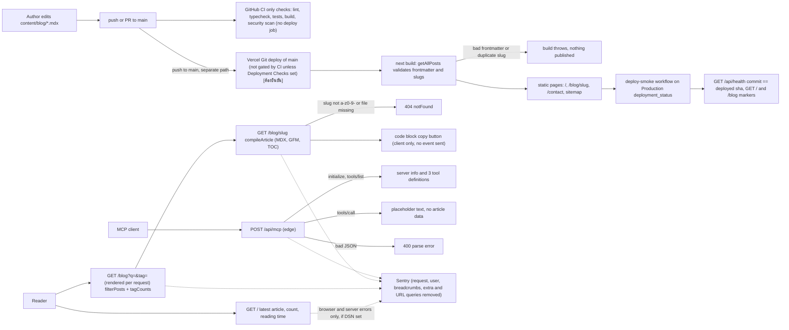
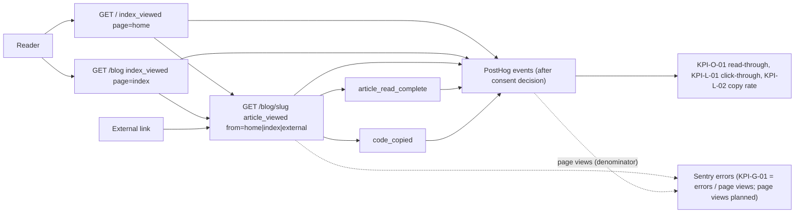

# 01 — Business process (As-Is / To-Be)

content-techblog-web คือสมุดบันทึกเทคนิค (Next.js + MDX) ที่เผยแพร่บทความ 5 เรื่องจากไฟล์ใน `content/blog/` ให้นักพัฒนาอ่านที่ techblog.bookchaowalit.com ไม่มี backend หรือฐานข้อมูล บทความถูก validate ตอน build; หน้า `/`, `/blog/<slug>`, `/contact` และ sitemap สร้างเป็น static ส่วน `/blog` อ่าน `q`/`tag` จาก `searchParams` จึงเรนเดอร์ตามคำขอทุกครั้ง ส่วน `/api/mcp` เป็น stub ที่ยังไม่คืนข้อมูลบทความจริง

Last reviewed: 2026-11-28 · commit `f1a020c`

## As-Is (จากโค้ดวันนี้)

Sources: `src/lib/posts.ts`, `src/app/blog/page.tsx`, `src/app/blog/[slug]/page.tsx`, `src/lib/compile-article.ts`, `src/app/api/mcp/route.ts`, `src/app/api/health/route.ts`, `.github/workflows/ci.yml`, `.github/workflows/deploy-smoke.yml`, `scripts/deploy-smoke.sh`, `src/lib/sentry.ts`, `PRODUCT.md`

ข้อเท็จจริงสำคัญจากโค้ด:

- `/api/mcp` ประกาศ tool 3 ตัว (`get_tech_posts`, `search_tech_content`, `get_tech_post`) แต่ `tools/call` ทุกชนิดตอบข้อความ placeholder `Implement your tech blog logic here` ไม่อ่านบทความ (ดู G2)
- `/api/health` คืน `commit` จาก `VERCEL_GIT_COMMIT_SHA` ซึ่งมีเฉพาะ deploy ผ่าน Git; deploy-smoke ใช้เทียบกับ commit ที่ deploy
- Sentry (`src/lib/sentry.ts`): `beforeSend` ลบ request, user, breadcrumbs, extra, contexts นอกกลุ่ม platform, ตัด query/hash ใน URL/ข้อความ error และลบ frame vars; เปิดทั้ง browser (`instrumentation-client.ts`) และ server (`instrumentation.ts` + `onRequestError`)
- analytics: ไม่มี event ถูกส่ง (Vercel Analytics ถูกถอนเมื่อ 2026-11-19); Sentry เปิดเมื่อมี `NEXT_PUBLIC_SENTRY_DSN`: [ต้องยืนยัน] ว่าตั้งบน production
- Vercel Git link: PRODUCT.md (ตรวจ 2026-11-19) บอกว่า push to main deploy production [ต้องยืนยัน] สถานะวันนี้

## To-Be (จาก docs/measurement/KPI-PLAN.md)

Sources: `docs/measurement/KPI-PLAN.md` (owner decision D4: PostHog chosen, no account yet; baseline target 2026-12-31)

## Gap

| ID | As-Is → To-Be | Status | Owner | Evidence |
|---|---|---|---|---|
| G1 | ไม่มี analytics event (ถอน Vercel Analytics แล้ว) → PostHog วัด read-through, click-through, copy rate | blocked | owner | `docs/measurement/KPI-PLAN.md` (D4: ยังไม่มี account/project key; ต้องตัดสิน consent ก่อน) |
| G2 | `/api/mcp` `tools/call` เป็น placeholder → คืนบทความจริงตาม tool ที่ประกาศ | decide | owner | `src/app/api/mcp/route.ts`; ไม่มี To-Be เขียนไว้ (owner ต้องตัดสินว่าจะทำหรือถอด endpoint) |
| G3 | ไม่มี baseline KPI → เก็บ baseline 4 สัปดาห์ (เป้า 2026-12-31) | blocked | owner | `docs/measurement/KPI-PLAN.md` (ขึ้นกับ G1) |

## Open questions

- Vercel project `bookchaowalit-techblog-frontend` ยัง deploy จาก Git ของ repo นี้อยู่หรือไม่ และโปรเจกต์เก่า `tech-blog` ยังเชื่อมอยู่หรือไม่ (PRODUCT.md ตรวจ 2026-11-19)
- `NEXT_PUBLIC_SENTRY_DSN` ตั้งบน production หรือไม่
